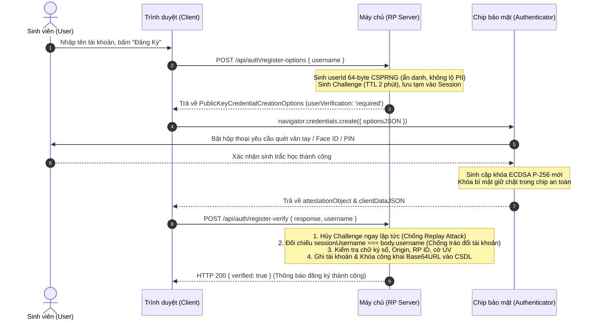
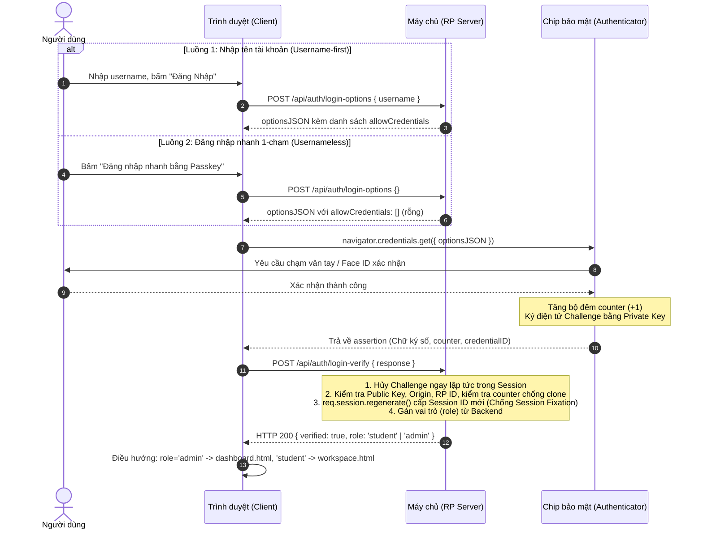
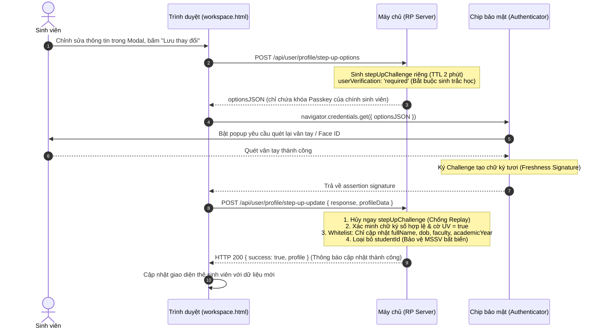

# Ứng Dụng Xác Thực Không Mật Khẩu FIDO2 / WebAuthn (Passkeys)

> Đồ án môn **Bảo Mật Thông Tin**, Viện Công Nghệ Việt - Nhật (VJIT), Trường Đại học Công nghệ TP.HCM (HUTECH).

Dự án hiện thực một ứng dụng web mô phỏng cổng thông tin và không gian làm việc sinh viên (HUTECH Workspace), ứng dụng chuẩn xác thực **FIDO2 / WebAuthn**. Người dùng đăng ký và đăng nhập bằng Passkey (Touch ID, Face ID, Windows Hello, YubiKey) thay cho mật khẩu truyền thống. Server chỉ lưu trữ Khóa công khai, nên rò rỉ cơ sở dữ liệu không làm lộ bí mật xác thực. Trình duyệt gắn tên miền thật (`origin`) vào mỗi chữ ký, ngăn chặn hoàn toàn các trang giả mạo (phishing) thu thập phiên xác thực.

---

## Mục lục

1. [Mục tiêu và phạm vi](#1-mục-tiêu-và-phạm-vi)
2. [Cơ chế bảo mật](#2-cơ-chế-bảo-mật)
3. [Kiến trúc, luồng xác thực và lưu trữ](#3-kiến-trúc-luồng-xác-thực-và-lưu-trữ)
4. [Công nghệ sử dụng](#4-công-nghệ-sử-dụng)
5. [Cấu trúc thư mục](#5-cấu-trúc-thư-mục)
6. [API endpoints](#6-api-endpoints)
7. [Biến môi trường](#7-biến-môi-trường)
8. [Cài đặt và vận hành](#8-cài-đặt-và-vận-hành)
9. [Kịch bản kiểm thử và demo](#9-kịch-bản-kiểm-thử-và-demo)
10. [Thành viên đóng góp](#10-thành-viên-đóng-góp)
11. [Quy trình làm việc với Git](#11-quy-trình-làm-việc-với-git)
12. [Hạn chế và hướng phát triển](#12-hạn-chế-và-hướng-phát-triển)
13. [Tài liệu tham khảo](#13-tài-liệu-tham-khảo)

---

## 1. Mục tiêu và phạm vi

**Mục tiêu**

- Tìm hiểu chuẩn FIDO2, gồm giao thức WebAuthn (W3C Level 2) và CTAP2 (FIDO Alliance).
- Xây dựng bản demo hoàn chỉnh hai luồng: đăng ký Passkey và đăng nhập bằng Passkey.
- Kiểm chứng bằng thực nghiệm các tính chất an ninh: chống phishing, chống tấn công phát lại (replay), và loại bỏ việc lưu trữ mật khẩu trên máy chủ.

**Phạm vi chức năng**

| Nhóm | Chức năng |
| :--- | :--- |
| **Xác thực** | Đăng ký Passkey, đăng nhập có username, đăng nhập nhanh không cần username (discoverable credential), đăng xuất |
| **Phân quyền** | Hai vai trò: **Admin** chuyển hướng vào `dashboard.html`, **Sinh viên** chuyển hướng vào `workspace.html` |
| **Không gian sinh viên** | Xem hồ sơ cá nhân, xem số lượng khóa Passkey đã liên kết, cập nhật hồ sơ qua Step-Up Authentication |
| **Quản trị (Admin)** | Xem danh sách tài khoản sinh viên, xem số liệu trực quan qua biểu đồ Chart.js (quyền truy cập kiểm soát ở API) |
| **Step-Up Authentication** | Yêu cầu xác thực lại sinh trắc học bằng Passkey khi chỉnh sửa các trường thông tin cá nhân |

---

## 2. Cơ chế bảo mật

| Nguy cơ | Chuẩn hoặc cơ chế | Cách xử lý | Vị trí mã nguồn |
| :--- | :--- | :--- | :--- |
| **Phishing, giả mạo tên miền** | WebAuthn §7.1, §7.2, §13.4.1 | Trình duyệt ghi `origin` thật vào `clientDataJSON`. Server so khớp nghiêm ngặt `expectedOrigin` và `expectedRPID`. | `routes/auth.js`, `routes/user.js` |
| **Tấn công phát lại (Replay)** | Cryptographic Challenge | Mỗi phiên xác thực sinh `challenge` ngẫu nhiên bằng CSPRNG, sống tối đa 2 phút và bị hủy ngay sau lần kiểm tra đầu tiên. | `routes/auth.js`, `routes/user.js` |
| **Nhân bản thiết bị xác thực** | Signature counter | Server từ chối khi `counter` nhận được nhỏ hơn hoặc bằng giá trị đã lưu. *(Lưu ý: nhiều Passkey đồng bộ qua iCloud Keychain/Google Password Manager giữ counter = 0 nên cơ chế này không áp dụng cho khóa đồng bộ).* | `routes/auth.js`, `db.js` |
| **Rò rỉ cơ sở dữ liệu** | Zero-Shared-Secret | Server chỉ lưu `credentialID`, `publicKey` và `counter`. Hoàn toàn không có mật khẩu hay khóa riêng. Dữ liệu hồ sơ (họ tên, ngày sinh, MSSV) vẫn là dữ liệu cá nhân cần bảo vệ. | `db.js` |
| **Đánh cắp khóa riêng** | Hardware Isolation | Khóa riêng tư được sinh và bảo vệ trong phần cứng an toàn (Secure Enclave, TPM, Security Key) và không bao giờ rời khỏi thiết bị. | Authenticator phần cứng |
| **Chiếm phiên làm việc** | Step-Up Authentication | Giảm thiểu rủi ro: kẻ chiếm được Cookie phiên vẫn đọc được hồ sơ, nhưng không thể sửa đổi thông tin nhạy cảm nếu thiếu thiết bị xác thực của người dùng. | `routes/user.js`, `public/js/workspace.js` |
| **Spam challenge, dò username** | Rate Limiting | Giới hạn 40 yêu cầu mỗi 5 phút trên các route xác thực (`authLimiter`), kết hợp `trust proxy` để nhận diện đúng IP phía sau reverse proxy. | `server.js` |
| **Tấn công đo thời gian (Timing)** | CWE-208 | So sánh mã thiết lập Admin (`ADMIN_SETUP_TOKEN`) bằng `crypto.timingSafeEqual` sau khi chuẩn hóa kiểm tra độ dài. | `routes/auth.js` |
| **Cố định phiên (Session Fixation)** | CWE-384 | Tái tạo lại Session ID bằng `session.regenerate()` ngay sau khi người dùng xác thực Passkey thành công. | `routes/auth.js` |
| **Chiếm quyền Admin ban đầu** | Bootstrap Token & Lockout | Khởi tạo Passkey Admin lần đầu bắt buộc phải cung cấp đúng `ADMIN_SETUP_TOKEN`. Khi đã có Passkey, endpoint đăng ký admin bị khóa vĩnh viễn (HTTP 400). | `routes/auth.js` |

---

## 3. Kiến trúc, luồng xác thực và lưu trữ

Hệ thống gồm ba thành phần theo đặc tả FIDO2:

- **Authenticator:** Thiết bị giữ khóa riêng và ký challenge (Touch ID, Face ID, Windows Hello, YubiKey).
- **Client:** Trình duyệt gọi WebAuthn API qua thư viện `@simplewebauthn/browser`.
- **Relying Party (RP):** Server Express sinh challenge và xác minh chữ ký qua `@simplewebauthn/server`.

### 3.1. Luồng đăng ký Passkey

Quy trình đăng ký áp dụng cơ chế **Khởi tạo trì hoãn (Deferred Creation)**: Máy chủ chỉ tạo mã người dùng tạm trong Session và chỉ ghi tài khoản chính thức vào CSDL sau khi xác minh thành công chữ ký sinh trắc học, ngăn ngừa hoàn toàn nguy cơ sinh "tài khoản rác" (Ghost Account) nếu người dùng hủy giữa chừng.

1. **Khởi tạo tùy chọn (Options Request):** Client gửi `POST /api/auth/register-options` kèm `username`. Máy chủ kiểm tra cú pháp regex, kiểm tra trùng lặp trong CSDL, sinh định danh người dùng `userId` ngẫu nhiên 64-byte CSPRNG (`crypto.randomBytes(64)`) bảo vệ quyền riêng tư (không chứa PII theo W3C §5.4.3), và sinh `challenge` ngẫu nhiên (thời gian sống TTL 2 phút).
2. **Cấu hình tham số bảo mật cốt lõi:**
   - `userVerification: 'required'`: Bắt buộc xác minh chính chủ qua sinh trắc học (Touch ID, Face ID, Windows Hello) hoặc PIN; cờ UV (User Verified) phải mang giá trị `true`.
   - `residentKey: 'preferred'`: Ưu tiên tạo Khóa lưu trú (Discoverable Credential) trực tiếp trong chip an toàn để phục vụ đăng nhập nhanh 1-chạm (Usernameless).
   - `attestationType: 'none'`: Tối ưu kích thước gói tin mạng và bảo vệ thông tin riêng tư phần cứng.
   - `pubKeyCredParams`: Ưu tiên thuật toán ES256 (ECDSA P-256, COSE alg `-7`) và RS256 (`-257`).
3. **Thực thi phần cứng (Hardware Ceremony):** Trình duyệt gọi `@simplewebauthn/browser` (`startRegistration`) tương tác với WebAuthn API `navigator.credentials.create()`. Chip bảo mật (Secure Enclave / TPM) kích hoạt cảm biến sinh trắc học, tạo cặp khóa bất đối xứng, lưu Khóa bí mật (Private Key) trong phần cứng và trả về `attestationObject` cùng `clientDataJSON`.
4. **Xác minh & Lưu trữ (Verification & Persistence):** Client gửi phản hồi lên `POST /api/auth/register-verify`.
   - **Chốt chặn an ninh:** Thu hồi Challenge ngay lập tức (`req.session.currentChallenge = null` chống Replay Attack), kiểm tra `req.session.registeringUsername === req.body.username` (chống tráo đổi danh tính giữa 2 bước - kịch bản A11/M9), kiểm tra hạn sống TTL (120 giây).
   - **Xác minh chữ ký số:** Kiểm tra tính toàn vẹn chữ ký, so khớp tuyệt đối `expectedOrigin` và `expectedRPID`, xác nhận cờ UP (User Present) và UV (User Verified).
   - **Ghi dữ liệu nguyên tử:** Gọi `createUser()` và `addCredentialToUser()`, nén Khóa công khai sang định dạng Base64URL gọn gàng và đồng bộ dữ liệu bền vững.



### 3.2. Luồng đăng nhập Passkey

Hệ thống hỗ trợ song song hai hình thức đăng nhập không mật khẩu, kết hợp cơ chế kiểm soát bộ đếm chống nhân bản và phân quyền điều hướng theo vai trò (RBAC):

1. **Hai hình thức xác thực linh hoạt:**
   - **Đăng nhập định danh (Username-first):** Người dùng nhập `username`, máy chủ truy vấn CSDL để lấy danh sách khóa `allowCredentials` thuộc tài khoản đó. Trình duyệt chỉ cho phép Authenticator ký bằng khóa tương ứng.
   - **Đăng nhập nhanh 1-chạm (Usernameless / Discoverable Credential):** Người dùng bấm thẳng nút *"Đăng nhập nhanh bằng Passkey"*. Máy chủ gửi về `allowCredentials: []` (mảng rỗng). Trình duyệt tự động mở kho khóa Passkey trong chip phần cứng ứng với `rpID = localhost`. Người dùng chạm vân tay chọn tài khoản, máy chủ tra cứu ngược qua `findUserByCredentialId(response.id)` để xác định danh tính.
2. **Xác minh chữ ký số & Phát hiện nhân bản phần cứng (Hardware Clone Detection):**
   - Máy chủ đối chiếu chữ ký assertion bằng Khóa công khai đã lưu trong CSDL.
   - Kiểm tra bộ đếm `counter`: Giá trị `counter` gửi lên phải lớn hơn giá trị đã lưu trong CSDL (ngoại lệ: cho phép nếu cả hai bằng 0 đối với Passkey đồng bộ đám mây như iCloud Keychain / Google Password Manager). Nếu `counter` giảm hoặc không đổi, máy chủ coi thiết bị là bản sao trái phép và từ chối phiên truy cập.
3. **Chống cố định phiên (Session Fixation Prevention) & Điều hướng:**
   - Gọi `req.session.regenerate()` để hủy Session ID cũ và phát hành Cookie `connect.sid` hoàn toàn mới sau khi xác thực thành công.
   - Gán vai trò (`req.session.role`) trực tiếp ở Backend và điều hướng:
     - Vai trò `admin` $\rightarrow$ chuyển hướng tới `dashboard.html` (Bảng điều khiển Quản trị).
     - Vai trò `student` $\rightarrow$ chuyển hướng tới `workspace.html` (Không gian làm việc Sinh viên).



### 3.3. Luồng Step-Up khi sửa hồ sơ sinh viên

Nhằm phòng chống triệt để nguy cơ **Chiếm đoạt phiên làm việc (Session Hijacking)** hoặc rủi ro **Quên khóa máy nơi công cộng (Unattended Terminal)**, hệ thống áp dụng mô hình bảo mật **Zero-Trust** thông qua cơ chế **Xác thực tăng cường tại chỗ (Just-In-Time Step-Up Authentication)**:

1. **Nguyên lý Zero-Trust:** Phiên đăng nhập Cookie hợp lệ (`loggedIn = true`) chỉ đủ quyền để *đọc* hồ sơ. Bất kỳ thao tác *chỉnh sửa dữ liệu nhạy cảm* nào đều bắt buộc người dùng phải quét lại vân tay/Face ID tươi (Freshness Verification) đúng thời điểm bấm nút lưu.
2. **Khởi tạo thử thách Step-Up độc lập:** Khi sinh viên bấm *"Lưu thay đổi"* trên `workspace.html`, Client gọi `POST /api/user/profile/step-up-options` để xin một `stepUpChallenge` riêng (TTL 2 phút) gắn trực tiếp với Session hiện tại, cấu hình bắt buộc `userVerification: 'required'` và `allowCredentials` chỉ chứa các khóa của chính tài khoản đó.
3. **Ký xác nhận & Gửi kèm payload:** Trình duyệt gọi WebAuthn API yêu cầu chạm lại cảm biến sinh trắc học. Sau khi quét thành công, Client gửi chữ ký tươi kèm dữ liệu cập nhật hồ sơ lên `POST /api/user/profile/step-up-update`.
4. **Xác minh mật mã & Chống Mass Assignment (Bảo vệ MSSV bất biến):**
   - Máy chủ hủy ngay `req.session.stepUpChallenge = null` (chống Replay Attack), kiểm tra TTL và xác minh chữ ký số ECDSA cùng cờ UV.
   - **Bảo vệ toàn vẹn MSSV:** Áp dụng kỹ thuật Whitelist Destructuring tại tầng Backend, chỉ trích xuất đúng 4 trường được phép cập nhật (`fullName`, `dob`, `faculty`, `academicYear`). Trường Mã số sinh viên (`studentId`) bị loại bỏ hoàn toàn khỏi đối tượng ghi đĩa, bảo đảm MSSV luôn là hằng số bất biến do nhà trường quản lý.



### 3.4. Lưu trữ dữ liệu và tính bền vững

Dữ liệu tài khoản được quản lý trong bộ nhớ RAM phục vụ truy xuất nhanh và được ghi bền vững qua cơ chế kép:

| Thời điểm | Hành vi lưu trữ |
| :--- | :--- |
| **Khởi động** | Nạp dữ liệu từ `data/users.json`, sau đó kết nối MongoDB Atlas. Nếu MongoDB Atlas có dữ liệu, nạp dữ liệu Cloud vào RAM và cập nhật bản sao xuống `data/users.json`. |
| **Khi dữ liệu thay đổi** | Ghi đồng bộ xuống `data/users.json` (ghi file tạm `.tmp` rồi đổi tên nguyên tử để chống hỏng file), đồng thời kích hoạt tác vụ chạy ngầm `syncUsersToCloud()` để đồng bộ lên MongoDB Atlas. |
| **Phiên làm việc (Session)** | Lưu trên MongoDB Atlas thông qua `connect-mongo` (`MongoStore`). Khởi động lại server không làm gián đoạn hay mất phiên của người dùng. |

> **Ghi chú môi trường Cloud**: Trên các dịch vụ PaaS có ổ đĩa tạm thời (ephemeral filesystem) như Render, file `data/users.json` sẽ bị đặt lại khi container khởi động lại. MongoDB Atlas là kho lưu trữ bền vững duy nhất bảo toàn dữ liệu trong cấu hình đó.

---

## 4. Công nghệ sử dụng

| Lớp | Công nghệ | Phiên bản trong `package.json` | Vai trò |
| :--- | :--- | :--- | :--- |
| **Runtime** | Node.js (ES Modules) | $\ge$ 18.0.0 (Khuyến nghị 20 LTS) | Nền tảng thực thi server |
| **Web Server** | Express | ^5.2.1 | Framework định tuyến và middleware |
| **Quản lý phiên** | express-session | ^1.19.0 | Tạo và quản lý Cookie phiên |
| **Lưu trữ phiên** | connect-mongo | ^6.0.0 | Lưu trữ Session trên MongoDB Atlas |
| **Cơ sở dữ liệu** | MongoDB Driver (`mongodb`) | ^7.7.0 | Kết nối và đồng bộ CSDL Cloud |
| **Giới hạn tần suất** | express-rate-limit | ^8.7.1 | Hạn chế spam API xác thực (`trust proxy`) |
| **FIDO2 Phía Server**| `@simplewebauthn/server` | ^14.0.3 | Sinh challenge và kiểm tra chữ ký WebAuthn |
| **FIDO2 Phía Client**| `@simplewebauthn/browser` | ^14.0.0 | Gọi WebAuthn API trên trình duyệt |
| **Giao diện** | HTML5, CSS3, JavaScript, Chart.js | - | Giao diện Responsive Glassmorphism |

---

## 5. Cấu trúc thư mục

```text
fido2/
├── server.js              # Khởi tạo Express, session, MongoStore, rate limit, proxy
├── db.js                  # Cơ chế CSDL (RAM cache, fallback users.json & sync MongoDB Atlas)
├── routes/
│   ├── auth.js            # API FIDO2: đăng ký, đăng nhập, 1-chạm, kiểm tra an ninh
│   └── user.js            # API hồ sơ sinh viên, Step-Up Authentication
├── public/
│   ├── index.html         # Cổng xác thực Passkey tập trung
│   ├── dashboard.html     # Bảng điều khiển Quản trị viên (Admin Dashboard)
│   ├── workspace.html     # Không gian làm việc và quản lý hồ sơ sinh viên
│   ├── css/
│   │   ├── style.css      # Giao diện cổng đăng nhập (Dark Glassmorphism)
│   │   ├── dashboard.css  # Giao diện trang Admin
│   │   └── workspace.css  # Giao diện Workspace sinh viên
│   └── js/
│       ├── webauthn.js    # Client WebAuthn: Register, Login, Quick Login, Step-Up
│       ├── ui.js          # Xử lý sự kiện trang đăng nhập/đăng ký
│       ├── workspace.js   # Xử lý hiển thị hồ sơ và cập nhật Step-Up cho sinh viên
│       └── dashboard.js   # Quản lý biểu đồ Chart.js và danh sách người dùng
├── data/
│   └── users.json         # File cache cục bộ (bị loại trừ bởi .gitignore)
├── .env.example           # File mẫu khai báo biến môi trường
├── package.json           # Danh sách gói phụ thuộc và scripts vận hành
└── README.md              # Tài liệu hướng dẫn kỹ thuật đồ án
```

---

## 6. API endpoints

Các endpoint xác thực được thiết kế theo kiểu **RPC (Remote Procedure Call)** qua HTTP POST, tương ứng với quy trình hai bước (`options` $\rightarrow$ `verify`) của chuẩn WebAuthn.

Hệ thống có **13 endpoints** (gồm 11 endpoints nghiệp vụ chính và 2 endpoints kiểm thử chỉ kích hoạt khi `NODE_ENV !== 'production'`):

| Phương thức | Endpoint | Quyền truy cập | Mô tả chức năng |
| :--- | :--- | :--- | :--- |
| **POST** | `/api/auth/register-options` | Công khai (Cần setup token nếu là admin) | Tạo challenge và tùy chọn đăng ký Passkey |
| **POST** | `/api/auth/register-verify` | Challenge trong session | Xác minh chữ ký đăng ký và lưu Khóa công khai |
| **POST** | `/api/auth/login-options` | Công khai | Tạo challenge đăng nhập (hỗ trợ cả luồng có và không username) |
| **POST** | `/api/auth/login-verify` | Challenge trong session | Xác minh chữ ký assertion, tạo phiên và cập nhật counter |
| **POST** | `/api/auth/logout` | Đã đăng nhập | Hủy phiên làm việc và xóa cookie `connect.sid` |
| **GET** | `/api/user/profile` | Đã đăng nhập | Xem thông tin hồ sơ chi tiết của người dùng |
| **GET** | `/api/user/me` | Đã đăng nhập | Lấy thông tin hồ sơ phục vụ Workspace sinh viên |
| **POST** | `/api/user/profile/step-up-options` | Đã đăng nhập | Tạo challenge xác thực bước 2 (Step-Up) |
| **POST** | `/api/user/profile/step-up-update` | Đã đăng nhập | Xác minh sinh trắc học và cập nhật hồ sơ cá nhân |
| **GET** | `/api/users` | **Vai trò Admin** | Lấy danh sách toàn bộ người dùng phục vụ Dashboard |
| **GET** | `/api/health` | Công khai | Kiểm tra trạng thái máy chủ và loại Session Store đang chạy |
| **GET** | `/api/session-debug` | Chỉ môi trường Dev | Kiểm tra trạng thái phiên làm việc nội bộ |
| **GET** | `/api/users-debug` | Môi trường Dev, vai trò Admin | Kiểm tra cấu trúc dữ liệu người dùng trong bộ nhớ |

---

## 7. Biến môi trường

Sao chép file `.env.example` thành `.env` tại thư mục gốc và cấu hình các biến phù hợp:

| Biến | Bắt buộc | Giá trị mặc định | Giải thích ý nghĩa |
| :--- | :---: | :--- | :--- |
| `PORT` | Không | `3000` | Cổng máy chủ Express lắng nghe |
| `NODE_ENV` | Không | `development` | Chế độ chạy (`development` hoặc `production`). Ở production, các route debug bị khóa hoàn toàn (404) |
| `MONGODB_URI` | Khi triển khai | Không có | Chuỗi kết nối MongoDB Atlas. Nếu thiếu, server fallback dùng MemoryStore và file `data/users.json` |
| `SESSION_SECRET` | Khi triển khai | Chuỗi ngẫu nhiên (RAM) | Khóa bí mật dùng để ký Cookie phiên. Trên Production nếu thiếu server sẽ dừng hoạt động (`process.exit(1)`) |
| `RP_ID` | Khi triển khai | `localhost` | Relying Party Identifier (Tên miền, không kèm giao thức `https://` và cổng) |
| `ORIGIN` | Khi triển khai | `http://localhost:3000` | Nguồn gốc chính thức chấp nhận WebAuthn (gồm cả giao thức và cổng) |
| `ADMIN_USERNAME` | Không | `admin` | Tên tài khoản quản trị hệ thống ban đầu |
| `ADMIN_SETUP_TOKEN`| Khi triển khai | Không có | Mã bí mật một lần bắt buộc phải cung cấp khi đăng ký Passkey cho tài khoản Admin |

---

## 8. Cài đặt và vận hành

**Yêu cầu hệ thống**

- Node.js phiên bản $\ge$ 18.0.0 (Khuyến nghị Node.js 20 LTS trở lên) và Git.
- Trình duyệt hiện đại hỗ trợ WebAuthn (Google Chrome, Microsoft Edge, Apple Safari, Mozilla Firefox).
- Thiết bị có cảm biến sinh trắc học tích hợp (Touch ID, Windows Hello) hoặc Khóa bảo mật phần cứng (FIDO2 Key).

**Các bước cài đặt**

```bash
# 1. Sao chép mã nguồn từ repository
git clone https://github.com/nguyenquockiet2462005/fido2.git
cd fido2

# 2. Cài đặt các gói phụ thuộc
npm install

# 3. Tạo file cấu hình từ file mẫu
cp .env.example .env
# Điền các giá trị MONGODB_URI, SESSION_SECRET, ADMIN_SETUP_TOKEN vào file .env

# 4. Khởi chạy máy chủ
npm start        # Khởi chạy chế độ thông thường
npm run dev      # Khởi chạy chế độ phát triển (tự reload khi sửa mã nguồn)
```

Truy cập ứng dụng tại địa chỉ: `http://localhost:3000` (hoặc cổng in ra trên terminal).

> [!IMPORTANT]
> Chuẩn W3C WebAuthn bắt buộc chạy qua giao thức bảo mật `https://` hoặc tên miền cục bộ `localhost` / `127.0.0.1`. Truy cập qua địa chỉ IP mạng nội bộ (ví dụ: `http://192.168.x.x:3000`) sẽ bị trình duyệt vô hiệu hóa WebAuthn API.

---

## 9. Kịch bản kiểm thử và demo

* **Kịch bản 1: Đăng ký và đăng nhập có username**
  1. Nhập username (ví dụ: `kiet`), bấm **Đăng ký**.
  2. Xác nhận vân tay / mã PIN trên popup của hệ điều hành $\rightarrow$ Đăng ký khóa thành công.
  3. Bấm **Đăng nhập** $\rightarrow$ Quét vân tay $\rightarrow$ Đăng nhập thành công và chuyển hướng đến `workspace.html`.
* **Kịch bản 2: Đăng nhập nhanh 1-chạm không cần username (Usernameless)**
  1. Để trống trường nhập tên tài khoản, bấm nút **"Đăng nhập nhanh Passkey"**.
  2. Trình duyệt tự động mở danh sách các Passkey đã lưu cho trang web.
  3. Chạm vân tay $\rightarrow$ Đăng nhập ngay lập tức mà không cần gõ bất kỳ thông tin nào.
* **Kịch bản 3: Phân quyền theo vai trò (RBAC)**
  1. Đăng nhập tài khoản Admin $\rightarrow$ Chuyển hướng vào `dashboard.html`.
  2. Đăng nhập tài khoản sinh viên $\rightarrow$ Chuyển hướng vào `workspace.html`. Nếu dùng tài khoản sinh viên gọi trực tiếp API `GET /api/users` (qua DevTools hoặc Postman) sẽ nhận mã lỗi **HTTP 403 (Forbidden)**. *(Lưu ý: Giao diện `dashboard.html` nằm trong thư mục `public/` tĩnh; việc bảo vệ phân quyền được thực thi chặt chẽ ở API dữ liệu).*
* **Kịch bản 4: Xác thực bước 2 (Step-Up Authentication)**
  1. Trong Workspace sinh viên, bấm nút **"Chỉnh sửa hồ sơ"**.
  2. Thay đổi thông tin Họ tên hoặc Ngày sinh, bấm **"Lưu thay đổi"**.
  3. Hệ thống kích hoạt cảm biến sinh trắc học yêu cầu người dùng chạm vân tay lần nữa để xác nhận quyền chủ thể trước khi cập nhật CSDL. Hủy thao tác thì thông tin không bị thay đổi.
* **Kịch bản 5: Bền vững dữ liệu và bảo toàn phiên**
  1. Đăng ký tài khoản và đăng nhập thành công.
  2. Tắt server (`Ctrl + C`) trong Terminal và khởi động lại (`npm start`).
  3. Tải lại trang web: Phiên làm việc vẫn được duy trì nguyên vẹn nhờ **MongoStore**, thông tin người dùng và Passkey không bị mất nhờ **MongoDB Atlas**.
* **Kịch bản 6: Chống tấn công phát lại (Replay Attack)**
  1. Mở tab Network trong DevTools, thực hiện đăng nhập và sao chép gói tin `POST /api/auth/login-verify`.
  2. Gửi lại chính xác gói tin này lần thứ hai qua công cụ như Postman hoặc `curl` $\rightarrow$ Server từ chối vì challenge đã bị hủy ngay sau lần kiểm tra đầu tiên.
* **Kịch bản 7: Chống tấn công giả mạo tên miền (Phishing)**
  1. Thử thay đổi `ORIGIN` trong `.env` khác với địa chỉ đang truy cập và thực hiện xác thực.
  2. Bước kiểm tra origin trên server thất bại, minh họa cơ chế phòng chống phishing của FIDO2.

---

## 10. Thành viên đóng góp

| STT | Họ và tên | MSSV |
| :-: | :--- | :--- |
| 1 | **Nguyễn Quốc Kiệt** | 24800612252 |
| 2 | **Nguyễn Trình Khoa** | 24800600488 |
| 3 | **Trương Nhựt Huy** | 24800600403 |
| 4 | **Ngô Thành Đạt** | 24800600203 |

---

## 11. Quy trình làm việc với Git

Nhánh `main` là bản ổn định dùng để báo cáo và nghiệm thu. Không commit hoặc push trực tiếp mã nguồn chưa qua kiểm thử lên nhánh `main`.

```bash
# 1. Cập nhật nhánh main mới nhất
git checkout main
git pull origin main

# 2. Tạo nhánh chức năng riêng (chỉ thực hiện lần đầu)
git checkout -b feature/<ten-chuc-nang>

# 3. Ghi nhận thay đổi
git add .
git commit -m "feat: mo ta ngan gon thay doi"

# 4. Đẩy nhánh lên GitHub
git push origin feature/<ten-chuc-nang>
```

Sau khi hoàn tất, mở Pull Request trên GitHub vào `main`. Nhóm trưởng tiến hành kiểm tra và thảo luận mã nguồn trước khi thực hiện gộp (Merge).

**Quy ước chung**

- Tuyệt đối không commit các file cấu hình nhạy cảm (`.env`), thư mục phụ thuộc (`node_modules/`), cache dữ liệu (`data/users.json`), khóa bí mật hay video demo dung lượng lớn.
- Đặt tiêu đề commit theo quy chuẩn Conventional Commits: `feat:`, `fix:`, `docs:`, `chore:`, `refactor:`.
- Khi gặp xung đột lúc `git pull`, ưu tiên dùng `git stash` hoặc giải quyết conflict cẩn trọng trước khi commit tiếp.

---

## 12. Hạn chế và hướng phát triển

**Hạn chế hiện tại**

- **Cơ chế khôi phục tài khoản (Account Recovery):** Chưa tích hợp quy trình cấp mã dự phòng (Backup Codes) hoặc xác thực qua kênh phụ khi người dùng mất toàn bộ thiết bị chứa Passkey.
- **Thẩm định chứng chỉ phần cứng (Attestation):** Đang cấu hình `attestation: 'none'` để ưu tiên tính riêng tư của người dùng (Anonymity) và khả năng tương thích cao nhất giữa các thiết bị; chưa tích hợp FIDO Metadata Service (MDS) để xác định nhà sản xuất authenticator.
- **WebAuthn Conditional UI:** Luồng 1-chạm hiện tại được kích hoạt thông qua nút bấm riêng biệt, chưa áp dụng cơ chế gợi ý tự động ngay trên ô nhập liệu form (`mediation: 'conditional'`).
- **Đồng bộ cơ sở dữ liệu bất đồng bộ:** Tác vụ đẩy dữ liệu lên MongoDB Atlas chạy ngầm sau khi đã ghi file cục bộ. Nếu tiến trình server bị ngắt đột ngột giữa hai bước, dữ liệu mới nhất có thể chưa kịp lưu lên Cloud. Khi khởi động lại, dữ liệu trên Cloud sẽ được nạp đè vào RAM.
- **Quy mô phiên bản (Single-instance):** Server nạp toàn bộ danh sách người dùng vào RAM phục vụ tìm kiếm nhanh, phù hợp cho mô hình đơn tiến trình (Single-instance). Việc chạy cụm nhiều instance song song chưa được đồng bộ qua distributed lock hay pub/sub.
- **Signature Counter trên Passkey đồng bộ:** Như đã nêu ở mục 2, kiểm tra chống nhân bản không phát huy tác dụng với các Authenticator đồng bộ giữ nguyên giá trị `counter = 0`.
- **Phạm vi Step-Up Authentication:** Cơ chế Step-Up chỉ áp dụng cho thao tác sửa đổi hồ sơ qua `step-up-update`. Việc đọc thông tin hồ sơ vẫn chỉ dựa vào Cookie phiên đăng nhập.

**Hướng mở rộng**

- Bổ sung tính năng cho phép một tài khoản đăng ký nhiều thiết bị Passkey dự phòng (Multi-device Passkeys).
- Xây dựng quy trình khôi phục tài khoản an toàn có sự xác thực của Quản trị viên hệ thống.
- Hiện thực WebAuthn Conditional UI khi trình duyệt hỗ trợ đầy đủ.
- Tích hợp FIDO2 làm yếu tố thứ hai (2FA/MFA) trong các hệ thống doanh nghiệp sẵn có.

---

## 13. Tài liệu tham khảo

1. W3C Recommendation, *[Web Authentication: An API for accessing Public Key Credentials Level 2](https://www.w3.org/TR/webauthn-2/)*.
2. FIDO Alliance, *[FIDO2: Web Authentication (WebAuthn) and Client to Authenticator Protocol (CTAP)](https://fidoalliance.org/specs/fido-v2.1-ps-20210615/)*.
3. SimpleWebAuthn Documentation, *[Architecture and Implementation Guide](https://simplewebauthn.dev/docs/)*.
4. MDN Web Docs, *[Web Authentication API](https://developer.mozilla.org/docs/Web/API/Web_Authentication_API)*.
5. MITRE, *[CWE-208: Observable Timing Discrepancy](https://cwe.mitre.org/data/definitions/208.html)*.
6. MITRE, *[CWE-384: Session Fixation](https://cwe.mitre.org/data/definitions/384.html)*.
7. OWASP Foundation, *[Application Security Verification Standard (ASVS) - V3 Session Management](https://owasp.org/www-project-application-security-verification-standard/)*.
