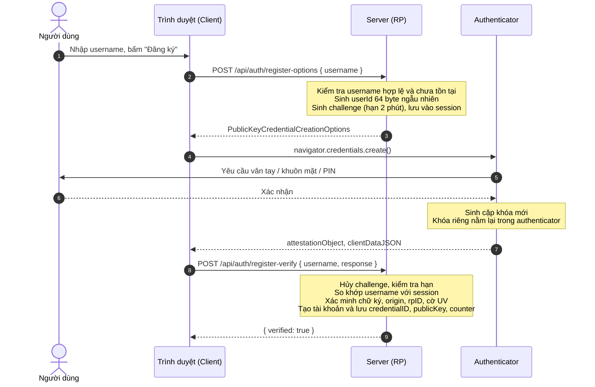
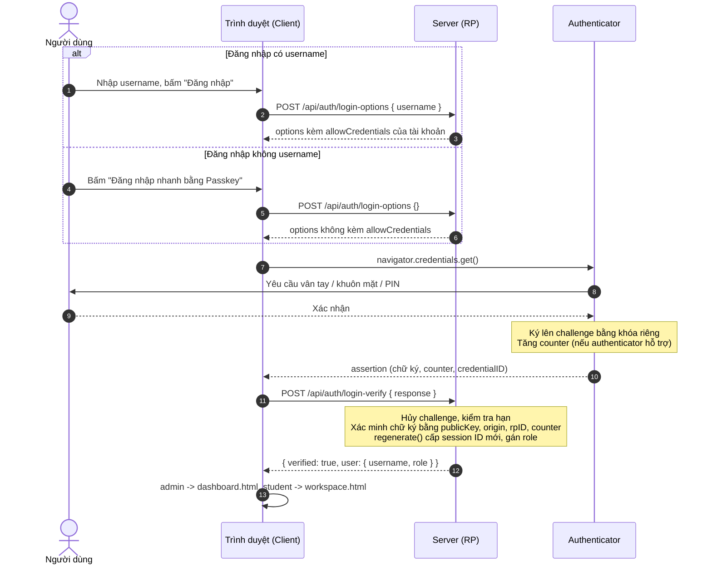
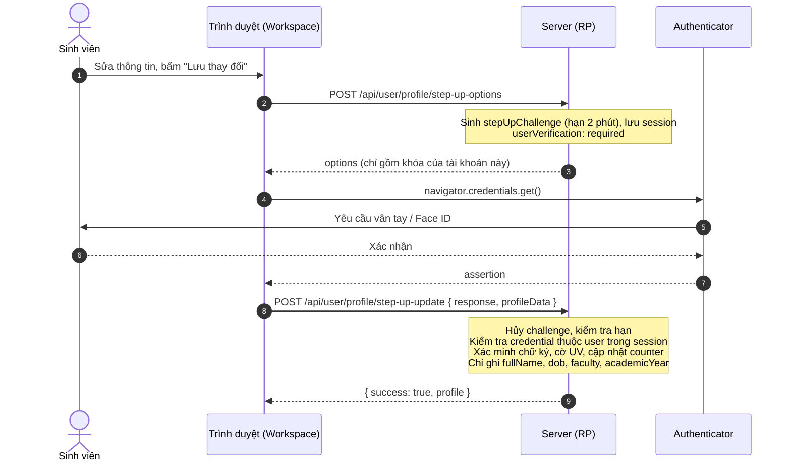

# Ứng Dụng Xác Thực Không Mật Khẩu FIDO2 / WebAuthn (Passkeys)

> Đồ án môn **Bảo Mật Thông Tin**, Viện Công Nghệ Việt - Nhật (VJIT), Trường Đại học Công nghệ TP.HCM (HUTECH).

Dự án hiện thực một ứng dụng web mô phỏng cổng thông tin và không gian làm việc sinh viên (HUTECH Workspace), ứng dụng chuẩn xác thực **FIDO2 / WebAuthn**. Người dùng đăng ký và đăng nhập bằng Passkey (Touch ID, Face ID, Windows Hello, YubiKey) thay cho mật khẩu truyền thống. Server chỉ lưu trữ Khóa công khai, nên rò rỉ cơ sở dữ liệu không làm lộ bí mật xác thực. Trình duyệt gắn tên miền thật (`origin`) vào dữ liệu được ký, nên trang giả mạo không thu thập được thông tin xác thực dùng lại được trên trang thật. Cơ chế này không thay thế các biện pháp chống XSS, chống đánh cắp cookie phiên sau đăng nhập hay chống mã độc trên máy người dùng.

---

## Mục lục

1. [Mục tiêu và phạm vi](#1-mục-tiêu-và-phạm-vi)
2. [Cơ chế bảo mật](#2-cơ-chế-bảo-mật)
3. [Kiến trúc, luồng xác thực và lưu trữ](#3-kiến-trúc-luồng-xác-thực-và-lưu-trữ)
4. [Công nghệ sử dụng](#4-công-nghệ-sử-dụng)
5. [Cấu trúc thư mục](#5-cấu-trúc-thư-mục)
6. [API endpoints](#6-api-endpoints)
7. [Biến môi trường](#7-biến-môi-trường)
8. [Cài đặt và vận hành](#8-cài-đặt-và-vận-hành)
9. [Kịch bản kiểm thử và demo](#9-kịch-bản-kiểm-thử-và-demo)
10. [Thành viên đóng góp](#10-thành-viên-đóng-góp)
11. [Quy trình làm việc với Git](#11-quy-trình-làm-việc-với-git)
12. [Hạn chế và hướng phát triển](#12-hạn-chế-và-hướng-phát-triển)
13. [Tài liệu tham khảo](#13-tài-liệu-tham-khảo)

---

## 1. Mục tiêu và phạm vi

**Mục tiêu**

- Tìm hiểu chuẩn FIDO2, gồm giao thức WebAuthn và CTAP2 (FIDO Alliance). Nhóm nghiên cứu theo WebAuthn Level 2; Level 3 đã trở thành W3C Recommendation ngày 25/8/2026. Các số mục `§` trong README trích theo Level 2.
- Xây dựng bản demo hoàn chỉnh hai luồng: đăng ký Passkey và đăng nhập bằng Passkey.
- Kiểm chứng bằng thực nghiệm các tính chất an ninh: chống phishing, chống tấn công phát lại (replay), và loại bỏ việc lưu trữ mật khẩu trên máy chủ.

**Phạm vi chức năng**

| Nhóm | Chức năng |
| :--- | :--- |
| **Xác thực** | Đăng ký Passkey, đăng nhập có username, đăng nhập nhanh không cần username (discoverable credential), đăng xuất |
| **Phân quyền** | Hai vai trò: **Admin** chuyển hướng vào `dashboard.html`, **Sinh viên** chuyển hướng vào `workspace.html` |
| **Không gian sinh viên** | Xem hồ sơ cá nhân, xem trạng thái Passkey đã liên kết (hiện mỗi tài khoản có đúng một Passkey), cập nhật hồ sơ qua Step-Up Authentication |
| **Quản trị (Admin)** | Xem danh sách tài khoản sinh viên, xem số liệu trực quan qua biểu đồ Chart.js (quyền truy cập kiểm soát ở API) |
| **Step-Up Authentication** | Yêu cầu xác thực lại sinh trắc học bằng Passkey khi chỉnh sửa các trường thông tin cá nhân |

---

## 2. Cơ chế bảo mật

| Nguy cơ | Chuẩn hoặc cơ chế | Cách xử lý | Vị trí mã nguồn |
| :--- | :--- | :--- | :--- |
| **Phishing, giả mạo tên miền** | WebAuthn §7.1, §7.2, §13.4.1 | Trình duyệt ghi `origin` thật vào `clientDataJSON`. Server so khớp nghiêm ngặt `expectedOrigin` và `expectedRPID`. | `routes/auth.js`, `routes/user.js` |
| **Tấn công phát lại (Replay)** | Cryptographic Challenge | Mỗi phiên xác thực sinh `challenge` ngẫu nhiên bằng CSPRNG, sống tối đa 2 phút và bị hủy ngay sau lần kiểm tra đầu tiên. | `routes/auth.js`, `routes/user.js` |
| **Nhân bản thiết bị xác thực** | Signature counter | Hàm `verifyAuthenticationResponse` của `@simplewebauthn/server` từ chối khi `counter` nhận được nhỏ hơn hoặc bằng giá trị đã lưu (trừ trường hợp cả hai bằng 0). Server cập nhật counter mới sau mỗi lần đăng nhập và Step-Up. *(Nhiều Passkey đồng bộ qua iCloud Keychain/Google Password Manager luôn giữ counter = 0, nên cơ chế này không áp dụng cho khóa đồng bộ).* | `routes/auth.js`, `routes/user.js`, `db.js` |
| **Rò rỉ cơ sở dữ liệu** | Zero-Shared-Secret | Server chỉ lưu `credentialID`, `publicKey` và `counter`. Hoàn toàn không có mật khẩu hay khóa riêng. Dữ liệu hồ sơ (họ tên, ngày sinh, MSSV) vẫn là dữ liệu cá nhân cần bảo vệ. | `db.js` |
| **Đánh cắp khóa riêng** | Hardware Isolation | Khóa riêng tư được sinh và bảo vệ trong phần cứng an toàn (Secure Enclave, TPM, Security Key) và không bao giờ rời khỏi thiết bị. | Authenticator phần cứng |
| **Chiếm phiên làm việc** | Step-Up Authentication | Giảm thiểu rủi ro: kẻ chiếm được Cookie phiên vẫn đọc được hồ sơ, nhưng không thể sửa đổi thông tin nhạy cảm nếu thiếu thiết bị xác thực của người dùng. | `routes/user.js`, `public/js/workspace.js` |
| **Spam challenge, dò username** | Rate Limiting | `authLimiter`: 40 yêu cầu mỗi 5 phút trên `/api/auth/*`. `globalApiLimiter`: 300 yêu cầu mỗi 15 phút trên toàn bộ `/api`. Bật `trust proxy` để nhận diện đúng IP phía sau reverse proxy. | `server.js` |
| **Tấn công đo thời gian (Timing)** | CWE-208 | Hàm `safeEqual` so sánh `ADMIN_SETUP_TOKEN` bằng `crypto.timingSafeEqual`. Hàm trả về `false` sớm khi hai chuỗi khác độ dài, nên thời gian phản hồi vẫn có thể lộ độ dài token (xem mục 12). | `routes/auth.js` |
| **Cố định phiên (Session Fixation)** | CWE-384 | Tái tạo lại Session ID bằng `session.regenerate()` ngay sau khi người dùng xác thực Passkey thành công. | `routes/auth.js` |
| **Chiếm quyền Admin ban đầu** | Bootstrap Token & Lockout | Khởi tạo Passkey Admin lần đầu bắt buộc phải cung cấp đúng `ADMIN_SETUP_TOKEN`. Khi đã có Passkey, endpoint đăng ký admin bị khóa (HTTP 400). Hệ quả: mất thiết bị Admin thì không tự khôi phục được qua giao diện (xem mục 12). | `routes/auth.js` |

### 2.1. Cấu hình phiên, CSRF và các lớp bảo vệ khác

| Hạng mục | Hiện trạng trong code | Vị trí |
| :--- | :--- | :--- |
| **Cookie phiên `connect.sid`** | `httpOnly: true`, `sameSite: 'lax'`, `secure: true` chỉ khi `NODE_ENV=production`, thời hạn 24 giờ (MongoStore `ttl` cũng 24 giờ), `saveUninitialized: false`. | `server.js` |
| **CSRF** | Không dùng CSRF token. Cookie `SameSite=Lax` khiến trình duyệt không gửi cookie trong các POST từ trang khác site. Step-Up và đăng nhập còn cần chữ ký từ authenticator. `POST /api/auth/logout` chỉ dựa vào SameSite. | `server.js` |
| **Security header / CSP** | Chưa cấu hình `helmet` hay Content-Security-Policy. | `server.js` |
| **Thư viện tải từ CDN** | `dashboard.html` nạp Chart.js từ `cdn.jsdelivr.net` không ghim phiên bản và không có SRI. `@simplewebauthn/browser` được phục vụ nội bộ tại `/vendor/...`, chỉ dùng unpkg (đã ghim `14.0.0`) làm dự phòng trên `index.html`. | `public/dashboard.html`, `public/index.html` |
| **Step-Up: ràng buộc credential** | `step-up-update` chỉ chấp nhận credential thuộc tài khoản trong session, bắt buộc UV và cập nhật counter sau khi xác minh. | `routes/user.js` |
| **Dữ liệu trả cho Admin** | `GET /api/users` trả `id`, `username`, `role`, toàn bộ `profile` (gồm MSSV, ngày sinh) và `id`/`counter`/`transports` của credential. Không trả `publicKey`. | `server.js` |

---

## 3. Kiến trúc, luồng xác thực và lưu trữ

Hệ thống gồm ba thành phần theo đặc tả FIDO2:

- **Authenticator:** Thiết bị giữ khóa riêng và ký challenge (Touch ID, Face ID, Windows Hello, YubiKey).
- **Client:** Trình duyệt gọi WebAuthn API qua thư viện `@simplewebauthn/browser`.
- **Relying Party (RP):** Server Express sinh challenge và xác minh chữ ký qua `@simplewebauthn/server`.

### 3.1. Luồng đăng ký Passkey

- **Chỉ tạo tài khoản sau khi xác minh:** `register-options` chỉ lưu `username`, `userId` và `challenge` tạm trong session. Tài khoản chỉ được ghi vào CSDL khi `register-verify` xác minh chữ ký thành công, nên người dùng hủy giữa chừng sẽ không để lại tài khoản rỗng.
- **User handle không chứa dữ liệu cá nhân:** `userId` là 64 byte ngẫu nhiên từ `crypto.randomBytes(64)` (WebAuthn §5.4.3), không suy ra được từ username.
- **Tham số chính:** `userVerification: 'required'`, `residentKey: 'preferred'` (để hỗ trợ đăng nhập không username), `attestationType: 'none'`.
- **Kiểm tra ở `register-verify`:** hủy challenge ngay khi đọc (chống replay), kiểm tra hạn 2 phút, yêu cầu `username` gửi lên trùng với `username` đã lưu trong session (chặn việc lấy challenge cho tài khoản A rồi đăng ký vào tài khoản B), từ chối nếu tài khoản đã tồn tại, rồi mới xác minh chữ ký, `origin`, `rpID` và cờ UV.



### 3.2. Luồng đăng nhập Passkey

Hệ thống hỗ trợ hai cách đăng nhập:

1. **Có username:** server trả `allowCredentials` gồm các khóa của tài khoản đó.
2. **Không username (discoverable credential):** server không gửi `allowCredentials`. Trình duyệt hiển thị các Passkey đã lưu cho `rpID` để người dùng chọn. Server tìm tài khoản theo `credentialID` qua `findUserByCredentialId()`.

Sau khi xác minh chữ ký và counter, server gọi `req.session.regenerate()` để cấp session ID mới (chống session fixation), lưu `role` vào session và trả `{ verified: true, user: { username, role } }`. Client chuyển `admin` sang `dashboard.html`, `student` sang `workspace.html`.



### 3.3. Luồng Step-Up khi sửa hồ sơ sinh viên

Cookie phiên đủ để xem hồ sơ, nhưng muốn sửa hồ sơ thì người dùng phải xác thực lại bằng Passkey ngay lúc bấm lưu. Mục đích là giảm thiệt hại khi cookie phiên bị lộ hoặc máy bị bỏ quên khi đang đăng nhập.

1. Client gọi `POST /api/user/profile/step-up-options`. Server sinh `stepUpChallenge` riêng (hạn 2 phút), lưu trong session, yêu cầu `userVerification: 'required'` và chỉ cho phép các khóa của tài khoản đang đăng nhập.
2. Sau khi người dùng xác thực, client gửi assertion cùng `profileData` trong một request tới `POST /api/user/profile/step-up-update`.
3. Server hủy challenge, kiểm tra hạn, kiểm tra credential thuộc đúng tài khoản trong session, xác minh chữ ký và cờ UV, rồi cập nhật counter.
4. Server chỉ lấy 4 trường `fullName`, `dob`, `faculty`, `academicYear` từ `profileData`. Trường `studentId` (MSSV) không bao giờ được ghi qua luồng này.

> [!NOTE]
> Chữ ký Step-Up ký lên challenge, không ký lên nội dung `profileData`. Mã độc chạy trong trình duyệt của người dùng vẫn có thể lừa người dùng xác thực rồi gửi kèm dữ liệu khác. Xem mục 12.



### 3.4. Lưu trữ dữ liệu và tính bền vững

Dữ liệu tài khoản được quản lý trong bộ nhớ RAM phục vụ truy xuất nhanh và được ghi bền vững qua cơ chế kép:

| Thời điểm | Hành vi lưu trữ |
| :--- | :--- |
| **Khởi động** | Nạp dữ liệu từ `data/users.json`, sau đó kết nối MongoDB Atlas. Nếu MongoDB Atlas có dữ liệu, nạp dữ liệu Cloud vào RAM và cập nhật bản sao xuống `data/users.json`. |
| **Khi dữ liệu thay đổi** | Ghi đồng bộ xuống `data/users.json` (ghi file tạm `.tmp` rồi đổi tên nguyên tử để chống hỏng file), đồng thời kích hoạt tác vụ chạy ngầm `syncUsersToCloud()` để đồng bộ lên MongoDB Atlas. |
| **Phiên làm việc (Session)** | Lưu trên MongoDB Atlas thông qua `connect-mongo` (`MongoStore`). Khởi động lại server không làm gián đoạn hay mất phiên của người dùng. |

> **Ghi chú môi trường Cloud**: Trên các dịch vụ PaaS có ổ đĩa tạm thời (ephemeral filesystem) như Render, file `data/users.json` sẽ bị đặt lại khi container khởi động lại. MongoDB Atlas là kho lưu trữ bền vững duy nhất bảo toàn dữ liệu trong cấu hình đó.

---

## 4. Công nghệ sử dụng

| Lớp | Công nghệ | Phiên bản trong `package.json` | Vai trò |
| :--- | :--- | :--- | :--- |
| **Runtime** | Node.js (ES Modules) | ≥ 20.19.0 (yêu cầu của `mongodb` 7.x) | Nền tảng thực thi server |
| **Web Server** | Express | ^5.2.1 | Framework định tuyến và middleware |
| **Quản lý phiên** | express-session | ^1.19.0 | Tạo và quản lý Cookie phiên |
| **Lưu trữ phiên** | connect-mongo | ^6.0.0 | Lưu trữ Session trên MongoDB Atlas |
| **Cơ sở dữ liệu** | MongoDB Driver (`mongodb`) | ^7.7.0 | Kết nối và đồng bộ CSDL Cloud |
| **Giới hạn tần suất** | express-rate-limit | ^8.7.1 | Hạn chế spam API xác thực (`trust proxy`) |
| **FIDO2 Phía Server**| `@simplewebauthn/server` | ^14.0.3 | Sinh challenge và kiểm tra chữ ký WebAuthn |
| **FIDO2 Phía Client**| `@simplewebauthn/browser` | ^14.0.0 | Gọi WebAuthn API trên trình duyệt |
| **Giao diện** | HTML5, CSS3, JavaScript, Chart.js | - | Giao diện Responsive Glassmorphism |

---

## 5. Cấu trúc thư mục

```text
fido2/
├── server.js              # Khởi tạo Express, session, MongoStore, rate limit, proxy
├── db.js                  # Cơ chế CSDL (RAM cache, fallback users.json & sync MongoDB Atlas)
├── routes/
│   ├── auth.js            # API FIDO2: đăng ký, đăng nhập, 1-chạm, kiểm tra an ninh
│   └── user.js            # API hồ sơ sinh viên, Step-Up Authentication
├── public/
│   ├── index.html         # Cổng xác thực Passkey tập trung
│   ├── dashboard.html     # Bảng điều khiển Quản trị viên (Admin Dashboard)
│   ├── workspace.html     # Không gian làm việc và quản lý hồ sơ sinh viên
│   ├── css/
│   │   ├── style.css      # Giao diện cổng đăng nhập (Dark Glassmorphism)
│   │   ├── dashboard.css  # Giao diện trang Admin
│   │   └── workspace.css  # Giao diện Workspace sinh viên
│   └── js/
│       ├── webauthn.js    # Client WebAuthn: Register, Login, Quick Login, Step-Up
│       ├── ui.js          # Xử lý sự kiện trang đăng nhập/đăng ký
│       ├── workspace.js   # Xử lý hiển thị hồ sơ và cập nhật Step-Up cho sinh viên
│       └── dashboard.js   # Quản lý biểu đồ Chart.js và danh sách người dùng
├── data/
│   └── users.json         # File cache cục bộ (bị loại trừ bởi .gitignore)
├── .env.example           # File mẫu khai báo biến môi trường
├── package.json           # Danh sách gói phụ thuộc và scripts vận hành
└── README.md              # Tài liệu hướng dẫn kỹ thuật đồ án
```

---

## 6. API endpoints

Các endpoint xác thực được thiết kế theo kiểu **RPC (Remote Procedure Call)** qua HTTP POST, tương ứng với quy trình hai bước (`options` → `verify`) của chuẩn WebAuthn.

Hệ thống có **13 endpoints** (gồm 11 endpoints nghiệp vụ chính và 2 endpoints kiểm thử chỉ kích hoạt khi `NODE_ENV !== 'production'`):

| Phương thức | Endpoint | Quyền truy cập | Mô tả chức năng |
| :--- | :--- | :--- | :--- |
| **POST** | `/api/auth/register-options` | Công khai (Cần setup token nếu là admin) | Tạo challenge và tùy chọn đăng ký Passkey |
| **POST** | `/api/auth/register-verify` | Challenge trong session | Xác minh chữ ký đăng ký và lưu Khóa công khai |
| **POST** | `/api/auth/login-options` | Công khai | Tạo challenge đăng nhập (hỗ trợ cả luồng có và không username) |
| **POST** | `/api/auth/login-verify` | Challenge trong session | Xác minh chữ ký assertion, tạo phiên và cập nhật counter |
| **POST** | `/api/auth/logout` | Đã đăng nhập | Hủy phiên làm việc và xóa cookie `connect.sid` |
| **GET** | `/api/user/profile` | Đã đăng nhập | Xem thông tin hồ sơ chi tiết của người dùng |
| **GET** | `/api/user/me` | Đã đăng nhập | Lấy thông tin hồ sơ phục vụ Workspace sinh viên |
| **POST** | `/api/user/profile/step-up-options` | Đã đăng nhập | Tạo challenge xác thực bước 2 (Step-Up) |
| **POST** | `/api/user/profile/step-up-update` | Đã đăng nhập | Xác minh sinh trắc học và cập nhật hồ sơ cá nhân |
| **GET** | `/api/users` | **Vai trò Admin** | Lấy danh sách toàn bộ người dùng phục vụ Dashboard |
| **GET** | `/api/health` | Công khai | Kiểm tra trạng thái máy chủ và loại Session Store đang chạy |
| **GET** | `/api/session-debug` | Chỉ môi trường Dev | Kiểm tra trạng thái phiên làm việc nội bộ |
| **GET** | `/api/users-debug` | Môi trường Dev, vai trò Admin | Kiểm tra cấu trúc dữ liệu người dùng trong bộ nhớ |

---

## 7. Biến môi trường

Sao chép file `.env.example` thành `.env` tại thư mục gốc và cấu hình các biến phù hợp:

| Biến | Bắt buộc | Giá trị mặc định | Giải thích ý nghĩa |
| :--- | :---: | :--- | :--- |
| `PORT` | Không | `3000` | Cổng máy chủ Express lắng nghe |
| `NODE_ENV` | Không | `development` | Chế độ chạy (`development` hoặc `production`). Ở production, các route debug bị khóa hoàn toàn (404) |
| `MONGODB_URI` | Khi triển khai | Không có | Chuỗi kết nối MongoDB Atlas. Nếu thiếu, server fallback dùng MemoryStore và file `data/users.json` |
| `SESSION_SECRET` | Khi triển khai | Chuỗi ngẫu nhiên (RAM) | Khóa bí mật dùng để ký Cookie phiên. Trên Production nếu thiếu server sẽ dừng hoạt động (`process.exit(1)`) |
| `RP_ID` | Khi triển khai | `localhost` | Relying Party Identifier (Tên miền, không kèm giao thức `https://` và cổng) |
| `ORIGIN` | Khi triển khai | `http://localhost:3000` | Nguồn gốc chính thức chấp nhận WebAuthn (gồm cả giao thức và cổng) |
| `ADMIN_USERNAME` | Không | `admin` | Tên tài khoản quản trị hệ thống ban đầu |
| `ADMIN_SETUP_TOKEN`| Khi triển khai | Không có | Mã bí mật một lần bắt buộc phải cung cấp khi đăng ký Passkey cho tài khoản Admin |

---

## 8. Cài đặt và vận hành

**Yêu cầu hệ thống**

- Node.js ≥ 20.19.0 (driver `mongodb` 7.x yêu cầu phiên bản này; script dùng cờ `--env-file`) và Git.
- Trình duyệt hiện đại hỗ trợ WebAuthn (Google Chrome, Microsoft Edge, Apple Safari, Mozilla Firefox).
- Thiết bị có cảm biến sinh trắc học tích hợp (Touch ID, Windows Hello) hoặc Khóa bảo mật phần cứng (FIDO2 Key).

**Các bước cài đặt**

```bash
# 1. Sao chép mã nguồn từ repository
git clone https://github.com/nguyenquockiet2462005/fido2.git
cd fido2

# 2. Cài đặt các gói phụ thuộc
npm install

# 3. Tạo file cấu hình từ file mẫu
cp .env.example .env
# Điền các giá trị MONGODB_URI, SESSION_SECRET, ADMIN_SETUP_TOKEN vào file .env

# 4. Khởi chạy máy chủ
npm start        # Khởi chạy chế độ thông thường
npm run dev      # Khởi chạy chế độ phát triển (tự reload khi sửa mã nguồn)
# Lệnh phụ trợ
npm test                  # Chạy kiểm thử an ninh tự động
npm run reset-db -- --yes # XÓA TOÀN BỘ tài khoản và phiên (cả users.json lẫn MongoDB Atlas mà MONGODB_URI trỏ tới)
```

Truy cập ứng dụng tại địa chỉ: `http://localhost:3000` (hoặc cổng in ra trên terminal).

> [!IMPORTANT]
> WebAuthn chỉ chạy trong secure context: `https://` hoặc `http://localhost`. Ngoài ra tên miền trên thanh địa chỉ phải trùng hoặc là tên miền con của `RP_ID`. Với `RP_ID=localhost`, hãy truy cập bằng `http://localhost:3000`. Truy cập qua `127.0.0.1` hay IP mạng nội bộ (`192.168.x.x`) sẽ bị trình duyệt từ chối. Khi triển khai production, `RP_ID` phải trùng tên miền thật và `ORIGIN` phải là địa chỉ `https://` đầy đủ.

---

## 9. Kịch bản kiểm thử và demo

* **Kịch bản 1: Đăng ký và đăng nhập có username**
  1. Nhập username (ví dụ: `kiet`), bấm **Đăng Ký**.
  2. Xác nhận vân tay / mã PIN trên popup của hệ điều hành → đăng ký thành công.
  3. Bấm **Đăng nhập** → quét vân tay → chuyển hướng đến `workspace.html`.
* **Kịch bản 2: Đăng nhập không cần username**
  1. Để trống ô tên tài khoản, bấm **"Đăng nhập nhanh bằng Passkey"**.
  2. Trình duyệt hiển thị danh sách Passkey đã lưu cho trang web.
  3. Chọn tài khoản, quét vân tay → đăng nhập mà không cần gõ thông tin.
* **Kịch bản 3: Phân quyền theo vai trò (RBAC)**
  1. Đăng nhập tài khoản Admin → chuyển hướng vào `dashboard.html`.
  2. Đăng nhập tài khoản sinh viên → chuyển hướng vào `workspace.html`. Dùng phiên sinh viên gọi trực tiếp `GET /api/users` (qua DevTools hoặc Postman) sẽ nhận **HTTP 403**. *(`dashboard.html` là file tĩnh trong `public/`; quyền truy cập dữ liệu được kiểm soát ở API.)*
* **Kịch bản 4: Step-Up Authentication**
  1. Trong Workspace sinh viên, bấm **"Chỉnh Sửa Hồ Sơ"**.
  2. Đổi Họ tên hoặc Ngày sinh, bấm lưu.
  3. Trình duyệt yêu cầu quét vân tay lần nữa trước khi server cập nhật CSDL. Hủy thao tác thì hồ sơ giữ nguyên. Ô MSSV hiển thị "Không thể chỉnh sửa".
* **Kịch bản 5: Bền vững dữ liệu và bảo toàn phiên** *(cần cấu hình `MONGODB_URI`)*
  1. Đăng ký tài khoản và đăng nhập thành công.
  2. Tắt server (`Ctrl + C`) và khởi động lại (`npm start`).
  3. Tải lại trang: phiên vẫn còn nhờ **MongoStore**, tài khoản và Passkey vẫn còn nhờ **MongoDB Atlas**.
* **Kịch bản 6: Chống tấn công phát lại (Replay)**
  1. Mở tab Network trong DevTools, đăng nhập và sao chép request `POST /api/auth/login-verify` (Copy as cURL).
  2. Gửi lại request này lần thứ hai → server từ chối vì challenge đã bị hủy sau lần kiểm tra đầu tiên.
* **Kịch bản 7: Ràng buộc tên miền (lớp chống phishing phía trình duyệt)**
  1. Chạy server với `RP_ID=localhost` (mặc định).
  2. Truy cập bằng `http://127.0.0.1:3000` thay vì `http://localhost:3000`, mở DevTools → Console, bấm **Đăng Ký** hoặc **Đăng nhập**.
  3. Trình duyệt ném lỗi `SecurityError` (RP ID không khớp tên miền hiện tại) và không mở popup sinh trắc học. Request chưa hề tới bước verify trên server.
  4. Ý nghĩa: trang ở tên miền khác (ví dụ trang giả mạo) không thể yêu cầu authenticator ký cho `RP_ID` của trang thật. Server còn kiểm tra `origin` và `rpID` lần nữa ở bước verify như lớp phòng thủ thứ hai.

---

## 10. Thành viên đóng góp

| STT | Họ và tên | Vai trò |
| :-: | :--- | :--- |
| 1 | **Nguyễn Quốc Kiệt** | Backend lõi (`routes/auth.js`, `routes/user.js`), thiết kế luồng Step-Up, refactor và rà soát an ninh. |
| 2 | **Nguyễn Trình Khoa** | Nghiên cứu WebAuthn API, cấu hình server (`server.js`), lớp dữ liệu (`db.js`) và kết nối MongoDB Atlas. |
| 3 | **Trương Nhựt Huy** | Phân tích vector tấn công (phishing, replay, session fixation, timing), viết kiểm thử tự động và kiểm thử thực nghiệm. |
| 4 | **Ngô Thành Đạt** | Frontend (`index.html`, `workspace.html`, `dashboard.html`), gọi WebAuthn API phía client, biểu đồ Chart.js. |

---

## 11. Quy trình làm việc với Git

Nhánh `main` là bản ổn định dùng để báo cáo và nghiệm thu. Không commit hoặc push trực tiếp mã nguồn chưa qua kiểm thử lên nhánh `main`.

```bash
# 1. Cập nhật nhánh main mới nhất
git checkout main
git pull origin main

# 2. Tạo nhánh chức năng riêng (chỉ thực hiện lần đầu)
git checkout -b feature/<ten-chuc-nang>

# 3. Ghi nhận thay đổi
git add .
git commit -m "feat: mo ta ngan gon thay doi"

# 4. Đẩy nhánh lên GitHub
git push origin feature/<ten-chuc-nang>
```

Sau khi hoàn tất, mở Pull Request trên GitHub vào `main`. Nhóm trưởng tiến hành kiểm tra và thảo luận mã nguồn trước khi thực hiện gộp (Merge).

**Quy ước chung**

- Tuyệt đối không commit các file cấu hình nhạy cảm (`.env`), thư mục phụ thuộc (`node_modules/`), cache dữ liệu (`data/users.json`), khóa bí mật hay video demo dung lượng lớn.
- Đặt tiêu đề commit theo quy chuẩn Conventional Commits: `feat:`, `fix:`, `docs:`, `chore:`, `refactor:`.
- Khi gặp xung đột lúc `git pull`, ưu tiên dùng `git stash` hoặc giải quyết conflict cẩn trọng trước khi commit tiếp.

---

## 12. Hạn chế và hướng phát triển

**Hạn chế hiện tại**

- **Cơ chế khôi phục tài khoản (Account Recovery):** Chưa tích hợp quy trình cấp mã dự phòng (Backup Codes) hoặc xác thực qua kênh phụ khi người dùng mất toàn bộ thiết bị chứa Passkey.
- **Thẩm định chứng chỉ phần cứng (Attestation):** Đang cấu hình `attestation: 'none'` để ưu tiên tính riêng tư của người dùng (Anonymity) và khả năng tương thích cao nhất giữa các thiết bị; chưa tích hợp FIDO Metadata Service (MDS) để xác định nhà sản xuất authenticator.
- **WebAuthn Conditional UI:** Luồng 1-chạm hiện tại được kích hoạt thông qua nút bấm riêng biệt, chưa áp dụng cơ chế gợi ý tự động ngay trên ô nhập liệu form (`mediation: 'conditional'`).
- **Đồng bộ cơ sở dữ liệu bất đồng bộ:** Tác vụ đẩy dữ liệu lên MongoDB Atlas chạy ngầm sau khi đã ghi file cục bộ. Nếu tiến trình server bị ngắt đột ngột giữa hai bước, dữ liệu mới nhất có thể chưa kịp lưu lên Cloud. Khi khởi động lại, dữ liệu trên Cloud sẽ được nạp đè vào RAM.
- **Quy mô phiên bản (Single-instance):** Server nạp toàn bộ danh sách người dùng vào RAM phục vụ tìm kiếm nhanh, phù hợp cho mô hình đơn tiến trình (Single-instance). Việc chạy cụm nhiều instance song song chưa được đồng bộ qua distributed lock hay pub/sub.
- **Signature Counter trên Passkey đồng bộ:** Như đã nêu ở mục 2, kiểm tra chống nhân bản không phát huy tác dụng với các Authenticator đồng bộ giữ nguyên giá trị `counter = 0`.
- **Phạm vi Step-Up Authentication:** Cơ chế Step-Up chỉ áp dụng cho thao tác sửa đổi hồ sơ qua `step-up-update`. Việc đọc thông tin hồ sơ vẫn chỉ dựa vào Cookie phiên đăng nhập.
- **Step-Up chưa gắn chữ ký với nội dung thay đổi:** Authenticator ký lên `stepUpChallenge`, không ký lên `profileData`. Mã độc trong trình duyệt có thể lừa người dùng xác thực rồi gửi kèm dữ liệu khác. Hướng khắc phục là transaction binding: đưa giá trị băm của `profileData` vào challenge và kiểm tra lại ở server.
- **Mỗi tài khoản chỉ có một Passkey:** `register-options` từ chối username đã tồn tại và chưa có luồng thêm khóa cho tài khoản đang đăng nhập.
- **Mất thiết bị của Admin:** Khi Admin đã có Passkey, endpoint đăng ký Admin bị khóa. Nếu mất thiết bị (hoặc Passkey không đồng bộ sang máy khác), không có cách khôi phục qua giao diện; phải can thiệp trực tiếp vào CSDL hoặc chạy `npm run reset-db -- --yes` (xóa toàn bộ dữ liệu).
- **So sánh token có thể lộ độ dài:** `safeEqual` trả về sớm khi hai chuỗi khác độ dài. Cách chặt chẽ hơn là băm SHA-256 cả hai vế rồi mới gọi `crypto.timingSafeEqual`.
- **Chưa có CSRF token, CSP và SRI:** Hệ thống dựa vào `SameSite=Lax` để chống CSRF, chưa cấu hình `helmet`/CSP, và Chart.js tải từ CDN không ghim phiên bản, không có SRI (xem mục 2.1).

**Hướng mở rộng**

- Bổ sung tính năng cho phép một tài khoản đăng ký nhiều thiết bị Passkey dự phòng (Multi-device Passkeys).
- Xây dựng quy trình khôi phục tài khoản an toàn có sự xác thực của Quản trị viên hệ thống, kể cả cho chính tài khoản Admin.
- Gắn chữ ký Step-Up với nội dung thay đổi (transaction binding).
- Bổ sung `helmet`/CSP, ghim phiên bản và thêm SRI cho thư viện tải từ CDN.
- Cập nhật theo WebAuthn Level 3.
- Hiện thực WebAuthn Conditional UI khi trình duyệt hỗ trợ đầy đủ.
- Tích hợp FIDO2 làm yếu tố thứ hai (2FA/MFA) trong các hệ thống doanh nghiệp sẵn có.

---

## 13. Tài liệu tham khảo

1. W3C Recommendation, *[Web Authentication: An API for accessing Public Key Credentials Level 2](https://www.w3.org/TR/webauthn-2/)* (bản được trích số mục trong README).
2. W3C Recommendation, *[Web Authentication: An API for accessing Public Key Credentials Level 3](https://www.w3.org/TR/webauthn-3/)* (25/8/2026).
3. FIDO Alliance, *[FIDO2: Web Authentication (WebAuthn) and Client to Authenticator Protocol (CTAP)](https://fidoalliance.org/specs/fido-v2.1-ps-20210615/)*.
4. SimpleWebAuthn Documentation, *[Architecture and Implementation Guide](https://simplewebauthn.dev/docs/)*.
5. MDN Web Docs, *[Web Authentication API](https://developer.mozilla.org/docs/Web/API/Web_Authentication_API)*.
6. MITRE, *[CWE-208: Observable Timing Discrepancy](https://cwe.mitre.org/data/definitions/208.html)*.
7. MITRE, *[CWE-384: Session Fixation](https://cwe.mitre.org/data/definitions/384.html)*.
8. OWASP Foundation, *[Application Security Verification Standard (ASVS) 4.0.3 - V3 Session Management](https://owasp.org/www-project-application-security-verification-standard/)*.
